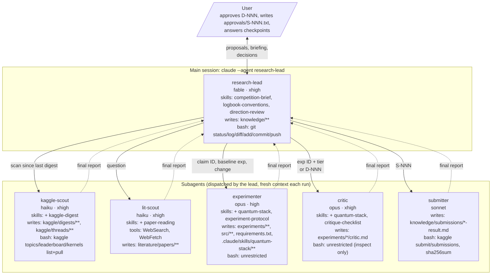
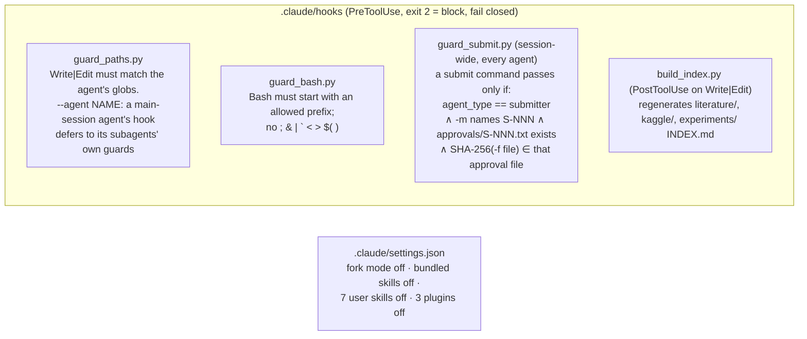
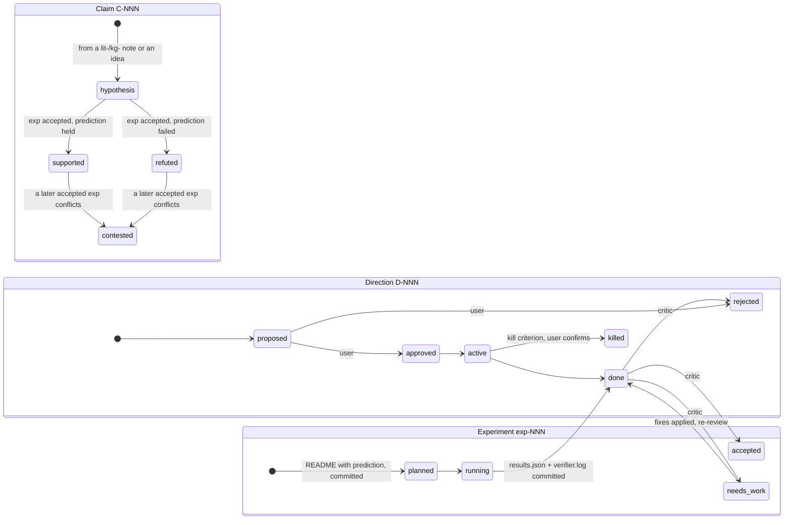

# Agent setup

How the research team in `.claude/` is wired: who does what, what each agent may touch, where the user decides, and how evidence flows. Diagrams are Mermaid (GitHub renders them). Source of truth is `.claude/agents/*.md`, `.claude/skills/*/SKILL.md`, `.claude/hooks/*.py` and `.claude/settings.json`; update this file when those change.

## 1. Roles, models and permissions (component view)



Every agent can read the whole repo and write only its own paths. Nothing is shared between runs except the files in the repo; a subagent's context dies with its run.

## 2. Guards (what the hooks enforce)



| Path | Written by | Guard |
|---|---|---|
| `knowledge/**` (claims, directions, plan, briefing, user-decisions, S-NNN) | research-lead | guard_paths |
| `kaggle/digests/**`, `kaggle/threads/**` | kaggle-scout | guard_paths + guard_bash |
| `literature/papers/**` | lit-scout | guard_paths |
| `experiments/**`, `src/**`, `requirements.txt`, `.claude/skills/quantum-stack/**` | experimenter | guard_paths |
| `experiments/*/critic.md` | critic | guard_paths |
| `knowledge/submissions/*-result.md` | submitter | guard_paths + guard_bash + guard_submit |
| `approvals/S-NNN.txt` | the user only | guard_submit reads it |
| `*/INDEX.md` | build_index.py | never by hand |

## 3. The research loop with the user's gates (sequence view)

```mermaid
sequenceDiagram
    actor U as User
    participant L as research-lead
    participant KS as kaggle-scout
    participant LS as lit-scout
    participant EX as experimenter
    participant CR as critic
    participant SB as submitter

    L->>KS: scan Kaggle since last digest
    KS-->>L: digest + thread notes (only threads with numbers/rules/techniques/nulls)
    L->>LS: question
    LS-->>L: paper notes with locators
    Note over L: findings → claims (status hypothesis)<br/>rank: expected gain per effort, 1-in-4 explore quota<br/>every high-relevance note → claim or "not pursued"

    L->>CR: review direction D-NNN (light, no files)
    CR-->>L: weakest assumption, counter-evidence, what a top-20 team would do
    L->>U: D-NNN proposal: options, recommendation, strongest counter-argument, critic dissent
    U-->>L: approve / reject + one-line prediction (recorded in user-decisions.md)

    loop per experiment (≤ 2 in parallel)
        L->>EX: claim ID, baseline exp, what to change
        Note over EX: pre-register → commit → build → verify → commit at each milestone<br/>README Status line so a cut-off run can resume
        EX-->>L: result in one line, prediction held?
        L->>CR: exp ID + tier (light | full)
        Note over CR: audit from committed artifacts<br/>re-run only on a named trigger<br/>full tier adds synthesis
        CR-->>L: critic.md: verdict, audit, analysis, suggested next
        opt needs-work
            L->>EX: apply Required fixes
            L->>CR: re-review (checks only the fixes)
        end
        Note over L: accepted → claim becomes supported / refuted
    end

    Note over L: update claims.md, plan.md, briefing.md<br/>git commit the logbook
    alt midterm check due or kill criterion fired
        L->>U: met / missed + recommendation; nothing more dispatched under D-NNN until answered
    end

    L->>U: S-NNN proposal (file path + SHA-256, per-task origin and our improvements)
    U->>U: write approvals/S-NNN.txt with the hash
    L->>SB: S-NNN
    Note over SB: hash check → submit once → poll → S-NNN-result.md<br/>guard_submit blocks everyone else
    SB-->>L: public score
```

## 4. Evidence states



Only an `accepted` experiment can move a claim. Papers and Kaggle posts can only create hypotheses.

## 5. Files the user reads

| File | What it gives you |
|---|---|
| `knowledge/briefing.md` | One page: where we stand per task, what we learned and why, open decisions, predicted vs actual (yours too) |
| `knowledge/plan.md` | The next experiments in order with expected gain and cost; "not pursued" with reasons. Veto anytime |
| `knowledge/directions/D-NNN-*.md` | The decisions you're asked to make, with options and dissent |
| `knowledge/submissions/S-NNN.md` | What a submission contains, its hash, and where each circuit came from |
| `knowledge/user-decisions.md` | Your standing decisions, quoted, so every agent inherits them |
| `experiments/INDEX.md`, `kaggle/INDEX.md`, `literature/INDEX.md` | Generated tables of everything, with verdicts |

## 6. Operating it

- Start: `claude --agent research-lead` (add `--continue` to resume its conversation).
- Approve a submission: `(Get-FileHash <zip> -Algorithm SHA256).Hash.ToLower() | Out-File -Encoding ascii approvals\S-NNN.txt`
- Kaggle auth: `KAGGLE_API_TOKEN` at Windows user scope (same token as `~/.kaggle/access_token`).
- The guards fail closed: a crashed hook blocks rather than allows.
- Known gaps: an agent with unrestricted Bash (experimenter, critic) could write into `approvals/`; a script that calls the Kaggle API internally is caught only if `competition_submit` appears on its command line. The experiment protocol forbids both.
